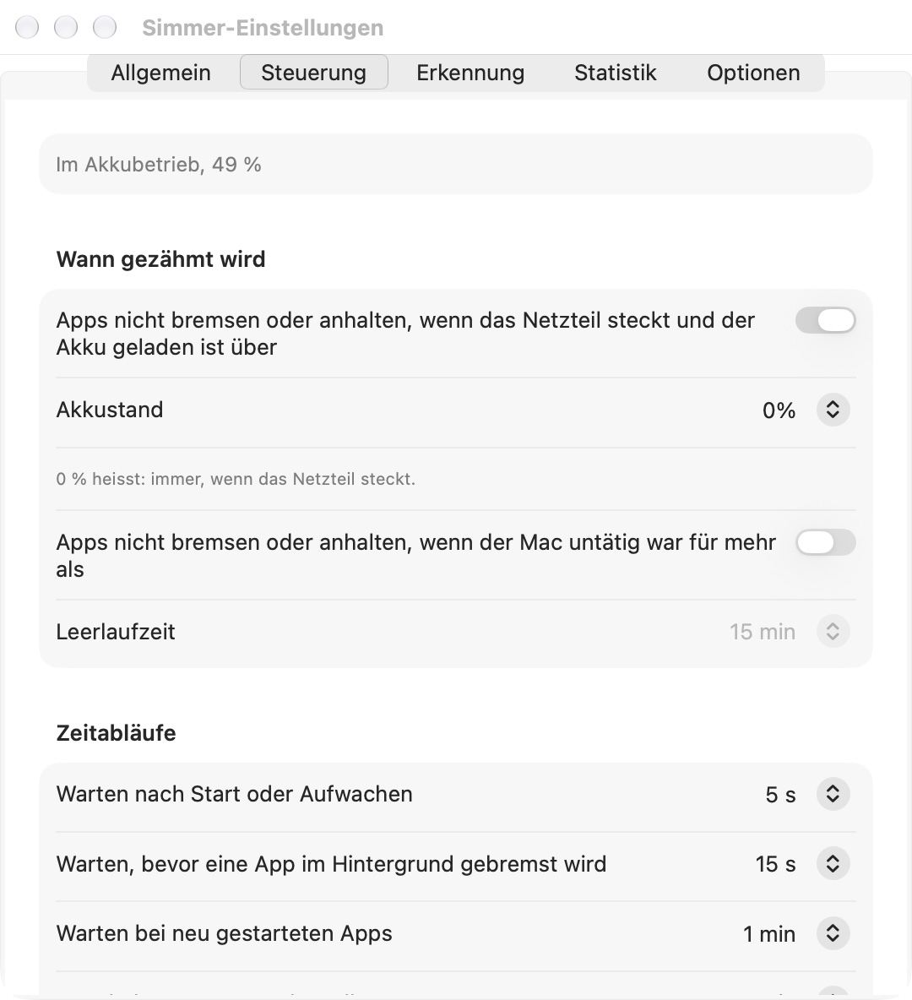

# Simmer

**Zähmt stromhungrige Apps, wenn dein Laptop am Akku hängt.** · [English](README.md)

Simmer sitzt neben der Uhr in der Menüleiste. Im Akkubetrieb legt es Apps, die du gerade nicht nutzt, auf die Effizienzkerne, bremst ihre CPU oder hält sie ganz an – und gibt ihnen volle Kraft zurück, sobald du sie nach vorne holst.

**Website:** https://ipstyle.github.io/simmer-docs/

## Download

| Fassung | Wo | Was sie kann |
|---|---|---|
| **Simmer** | [Neuestes Release](https://github.com/ipstyle/simmer-docs/releases/latest) – signiert und von Apple notarisiert | alles unten |
| **Simmer Lite** | Mac App Store (bald) | nur Effizienzkerne – die Sandbox des App Store verbietet, andere Apps anzuhalten oder zu bremsen |

Ab macOS 26, Apple Silicon oder Intel.

## Funktionen

- **Akku zuerst:** nur im Akkubetrieb zähmen oder immer; Schwelle für den Ladestand; Pause, wenn du untätig bist.
- **Regeln je App:** Effizienzkerne im Hintergrund · CPU-Grenze 1 % bis 500 % · im Hintergrund anhalten · nach N Minuten ausblenden oder beenden · Priorität.
- **Vorlagen** für Browser, Mail, Musik, Spotlight und Backups.
- **Schutz:** wichtige System-Prozesse bleiben unangetastet; Apps, die Ton abspielen oder herunterladen, bleiben in Ruhe; eine angehaltene App wacht beim Anklicken sofort auf.
- **Menüleiste:** Flamme mit CPU-Last, Last der Leistungs- und Effizienzkerne, Panel mit den fleissigsten Prozessen und den gezähmten Apps; das Panel lässt sich abreissen.
- **Meldung**, wenn eine App zu lange viel CPU braucht – mit Begrenzen per Klick.
- **Helfer (freiwillig):** steuert auch System-Prozesse und beschleunigt Time-Machine-Backups. Beendet sich Simmer oder stürzt ab, gibt der Helfer sofort alle Apps frei.
- **AppleScript:** `autostop`, `wake`, `manage`.
- Englisch und Deutsch.

## Freigaben

| Funktion | Freigabe |
|---|---|
| System-Prozesse, Time-Machine-Turbo | Helfer – einmal in Systemeinstellungen → Allgemein → Anmeldeobjekte erlauben |
| CPU-Meldungen | Mitteilungen |

## Datenschutz

Kein Konto, kein Tracking, kein Netzwerk. Siehe [PRIVACY.md](PRIVACY.md).

## Hilfe

Fehler und Ideen: [Issues](https://github.com/ipstyle/simmer-docs/issues).

---
Freeware · © 2026 ipstyle · Dieses Repo enthält nur Doku und Releases; der Quellcode ist nicht öffentlich.
