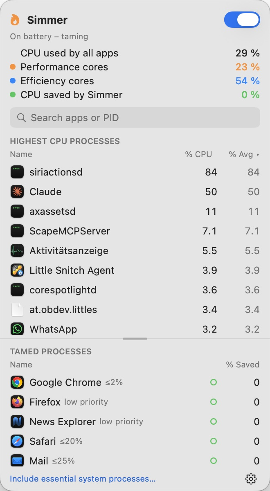

# Simmer

**Tame power-hungry apps when your laptop runs on battery.** · [Deutsch](README.de.md)

Simmer sits next to the clock in the menu bar. While you run on battery it moves apps you are not using onto the efficiency cores, caps their CPU, or pauses them completely — and gives them full speed the moment you bring them to the front.

**Website:** https://ipstyle.github.io/simmer-docs/

## Download

| Edition | Where | What it can do |
|---|---|---|
| **Simmer** | [Latest release](https://github.com/ipstyle/simmer-docs/releases/latest) — signed and notarized | everything below |
| **Simmer Lite** | Mac App Store (coming soon) | efficiency cores only — the App Store sandbox forbids pausing or limiting other apps |

Requires macOS 26 or later, Apple silicon or Intel.

## Features

- **Battery first:** tame only on battery, or always; optional charge-level threshold; pause when you are idle.
- **Per-app rules:** efficiency cores in background · CPU limit from 1 % to 500 % · stop while in background · hide or quit after N idle minutes · priority.
- **Presets** for browsers, Mail, Music, Spotlight and backups.
- **Protection:** essential system processes are never touched; apps playing audio or downloading are left alone; a stopped app wakes at once when you click it.
- **Menu bar:** flame icon with live CPU, load of performance and efficiency cores, panel with top processes and tamed apps; the panel can be torn off.
- **Alerts** when an app burns CPU too long, with a one-click limit.
- **Helper (optional):** controls system processes and can speed up Time Machine backups. If Simmer quits or crashes, the helper releases every app at once.
- **AppleScript:** `autostop`, `wake`, `manage`.
- English and German.

## Permissions

| Feature | Permission |
|---|---|
| System processes, Time Machine boost | Helper — approve once in System Settings → General → Login Items |
| High-CPU alerts | Notifications |

## Privacy

No account, no tracking, no network access. See [PRIVACY.md](PRIVACY.md).

## Support

Bugs and ideas: [issues](https://github.com/ipstyle/simmer-docs/issues).

---
Freeware · © 2026 ipstyle · This repository holds documentation and releases only; the source code is not public.
